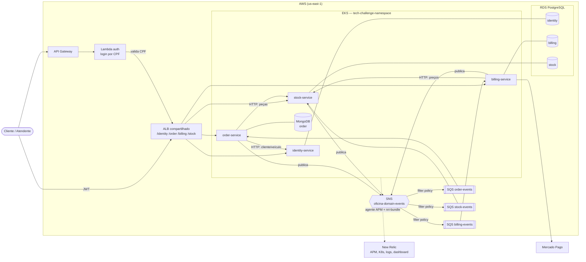

# Tech Challenge — Fase 4: Oficina Mecânica em microsserviços

Pós-graduação FIAP. Nesta fase o monolito da oficina foi dividido em quatro
microsserviços, cada um com o próprio banco, que conversam por eventos (Saga
coreografada via SNS/SQS) e rodam no EKS, com observabilidade no New Relic.

## Vídeo de demonstração (até 15 min)

> **Link:** [pasta do vídeo no Google Drive](https://drive.google.com/drive/folders/1lh3C0epIgxDlT67pXlC3IdDHHwV4oc2z?usp=sharing)

## Repositórios

Organização: [tech-challenge-pos-fiap-debora](https://github.com/tech-challenge-pos-fiap-debora)

| Repositório | Conteúdo |
|---|---|
| [identity-service](https://github.com/tech-challenge-pos-fiap-debora/identity-service) | Autenticação, usuários, clientes e veículos |
| [order-service](https://github.com/tech-challenge-pos-fiap-debora/order-service) | Ciclo de vida da ordem de serviço (OS) |
| [billing-service](https://github.com/tech-challenge-pos-fiap-debora/billing-service) | Orçamento e pagamento (Mercado Pago) |
| [stock-service](https://github.com/tech-challenge-pos-fiap-debora/stock-service) | Catálogo de peças, lotes e reserva |
| [lambda-auth](https://github.com/tech-challenge-pos-fiap-debora/lambda-auth) | Login do cliente por CPF (API Gateway + Lambda) |
| [infra-kubernetes](https://github.com/tech-challenge-pos-fiap-debora/infra-kubernetes) | VPC, EKS, ECR, SNS/SQS, ALB, New Relic e manifestos K8s |
| [infra-database](https://github.com/tech-challenge-pos-fiap-debora/infra-database) | RDS PostgreSQL e um database por serviço |

Ordem de deploy: `infra-kubernetes` → `infra-database` → `lambda-auth` →
`identity` → `stock` → `billing` → `order`.

## Arquitetura final



- **Entrada:** um único ALB com prefixo por serviço; o login do cliente passa
  pela Lambda, que emite um JWT assinado com o segredo compartilhado.
- **Dados:** *database per service*. Identity, billing e stock têm cada um seu
  database no mesmo RDS PostgreSQL; order usa MongoDB com volume EBS.
- **Comunicação síncrona (HTTP):** apenas consultas que precisam de resposta
  imediata (dados do cliente, catálogo e preço de peças).
- **Comunicação assíncrona:** tudo que muda estado entre serviços vai por
  evento — um tópico SNS e uma fila SQS por consumidor, com *filter policy*
  pelo atributo `type`.

## Saga Pattern: coreografia

Não existe orquestrador. Cada serviço reage aos eventos que lhe interessam e
publica o resultado; o `correlationId` da saga é o id da OS.

**Fluxo feliz**

| # | Evento | Publicado por | Quem reage | Efeito |
|---|---|---|---|---|
| 1 | `order.budget.requested` | order | billing | gera o orçamento da OS |
| 2 | `billing.budget.generated` | billing | order, stock | OS vai para `WAITING_APPROVAL`; stock prepara a reserva das peças |
| 3 | `order.budget.approved` | order | billing, stock | billing marca o orçamento como aprovado; stock reserva as peças (FIFO) |
| 4 | `stock.reserved` | stock | billing | cria a cobrança no Mercado Pago |
| 5 | `billing.payment.created` | billing | order | OS vai para `WAITING_PAYMENT` |
| 6 | `billing.payment.confirmed` | billing | order, stock | OS vai para `IN_EXECUTION`; reserva vira baixa |

**Compensações**

| Falha | Evento | Compensação |
|---|---|---|
| Cliente reprova o orçamento | `order.budget.rejected` | billing marca o orçamento como reprovado; stock libera a reserva |
| Falta peça | `stock.reservation.failed` | billing cancela o orçamento; order cancela a OS |
| Pagamento recusado | `billing.payment.failed` | stock libera a reserva; order cancela a OS |
| Erro ao orçar | `billing.budget.failed` | order cancela a OS |
| OS cancelada | `order.cancelled` | billing cancela o orçamento e estorna o pagamento; stock libera a reserva |

**Por que coreografia:** são só três participantes e um fluxo linear, então um
orquestrador seria mais um serviço para manter e um ponto único de falha. Com
coreografia cada serviço continua dono das próprias regras, os serviços não se
conhecem (só conhecem os eventos) e um consumidor fora do ar não perde
mensagens, porque elas ficam na fila SQS. O custo — visão do fluxo espalhada —
é coberto pelo `correlationId` nos logs e pelo dashboard da saga no New Relic.

## Divisão dos microsserviços

Os limites seguem os *bounded contexts* do domínio da oficina:

- **identity** — quem é o usuário e de quem é o veículo. É consultado por
  todos e muda pouco, então fica isolado e com banco relacional.
- **order** — dono do ciclo de vida da OS, incluindo diagnóstico, execução e
  entrega (a "fila da oficina" não virou um serviço à parte porque é o mesmo
  agregado). O documento da OS tem estrutura variável (serviços, peças,
  histórico de status), por isso MongoDB.
- **billing** — orçamento e pagamento. Isola a integração com o Mercado Pago e
  regras financeiras, que exigem transação: PostgreSQL.
- **stock** — catálogo, lotes e reserva FIFO. Concorrência na reserva pede
  consistência forte: PostgreSQL.

**Tecnologias**

| Camada | Escolha | Motivo |
|---|---|---|
| Serviços | Node.js + NestJS 11, TypeScript, Clean Architecture | mesma stack do monolito, módulos e injeção de dependência |
| Bancos | PostgreSQL (RDS) com TypeORM; MongoDB com Mongoose | relacional onde há transação, documento para a OS |
| Mensageria | SNS + SQS | fan-out com filtro por tipo e retenção sem servidor para manter |
| Auth | Lambda (Node 20) + API Gateway, JWT HS256 | login do cliente sem subir mais um pod |
| Plataforma | EKS, ALB Ingress, HPA, Kustomize | escala por serviço com um único ponto de entrada |
| IaC e CI/CD | Terraform (state no S3), GitHub Actions, ECR | cada repositório publica a própria imagem e aplica o próprio deploy |
| Observabilidade | New Relic (APM, nri-bundle, logs, eventos customizados) | rastreio entre serviços e dashboard de negócio da OS |

## Lab local

Os quatro serviços também sobem em Docker, com LocalStack no lugar de SNS/SQS.

| Serviço | Pasta | API | Banco | LocalStack |
|---|---|---|---|---|
| identity | `identity-service` | `:3001` | Postgres `:5433` | — (só HTTP) |
| stock | `stock-service` | `:3002` | Postgres `:5434` | `:4568` → fila `stock-events` |
| order | `order-service` | `:3003` | Mongo `:27018` | `:4567` → fila `order-events` |
| billing | `billing-service` | `:3004` | Postgres `:5435` | `:4566` → fila `billing-events` |

Rede Docker compartilhada: **`oficina-net`**. Um LocalStack por domínio (SNS +
SQS + policies + FilterPolicy); o publisher faz fan-out nos 3 brokers
(`SNS_FANOUT_ENDPOINTS`).

```bash
docker network create oficina-net 2>/dev/null || true

cd identity-service && docker compose up -d && cd ..
cd stock-service    && docker compose up -d && cd ..
cd order-service    && docker compose up -d && cd ..
cd billing-service  && docker compose up -d && cd ..
```

Login demo (seed do identity): `admin@local.dev` / `admin123`.
Swagger: `http://localhost:3001/api` … `3004/api`.

Logs da saga:

```bash
docker logs -f order   2>&1 | grep -E 'published type=|consume type='
docker logs -f billing 2>&1 | grep -E 'published type=|consume type='
docker logs -f stock   2>&1 | grep -E 'published type=|consume type='
```

Detalhes de domínio: README de cada pasta.

- [identity-service](https://github.com/tech-challenge-pos-fiap-debora/identity-service#readme)
- [order-service](https://github.com/tech-challenge-pos-fiap-debora/order-service#readme)
- [billing-service](https://github.com/tech-challenge-pos-fiap-debora/billing-service#readme)
- [stock-service](https://github.com/tech-challenge-pos-fiap-debora/stock-service#readme)
- [lambda-auth](https://github.com/tech-challenge-pos-fiap-debora/lambda-auth#readme)
- [infra-kubernetes](https://github.com/tech-challenge-pos-fiap-debora/infra-kubernetes#readme)
- [infra-database](https://github.com/tech-challenge-pos-fiap-debora/infra-database#readme)
